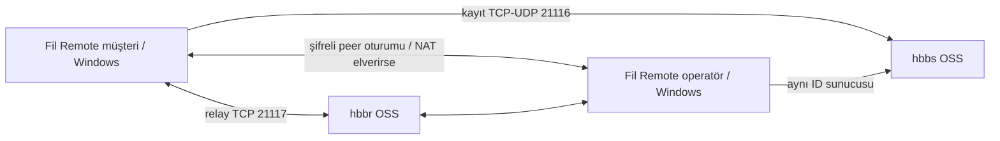

# Mimari

hbbs kimlik/kayıt/NAT koordinasyonu, hbbr relay sağlar. Parola denetimi müşteri istemcisindedir; hbbs parolaları saklayan bir hesap servisi değildir. 21115 TCP NAT kontrolüdür. 21118/21119 WebSocket listener'ları upstream içinde var olabilir, dışarı publish edilmez. Pro API 21114 yoktur.

`config/*.local.json` → Python doğrulayıcı → `client/src/fil_build_config.rs` → `fil_remote::initialize()` → upstream config override/default/hard/builtin tabloları. Yalnız public key gömülür. Üretim ve development uygulama adları/veri dizinleri farklıdır; operatör ayrıca ayrılır. Pro custom.txt imza formatı değiştirilmedi; Fil politikası bağımsız OSS kodudur.

Customer `conn-type=incoming`, operator `outgoing`; mevcut Flutter ID/parola/bağlantı komponentleri korunur. UI ve core ayrı DLL başlatma yollarında aynı politika uygulanır. Filename host/key ile build politikası aşılamaz. Protokol sürümü upstream 1.5.0 kalır; ürün sürümü 0.1.0-dev'dir.

TAO testi: proje bridge ağı, host üzerinde yalnız 127.0.0.1 publish. Docker internal ağında bu daemon port publish etmediği için standart izole bridge kullanıldı. Host firewall'a elle müdahale yok. Container dış ağa çıkabilir; sunucunun upstream update isteği kaldırıldı. Runtime minimal Debian tabanlıdır; derleyici runtime içinde yoktur.

Resmî kaynaklar: https://rustdesk.com/docs/en/self-host/ ve https://rustdesk.com/docs/en/self-host/rustdesk-server-oss/install/.
